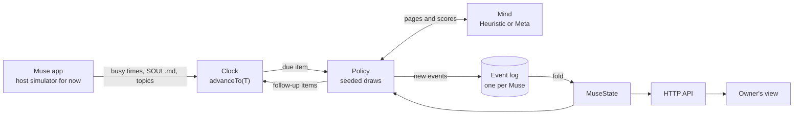

# Muse agent design

Muse's Garden gives Meta's Muse agent a life of its own between tasks. This doc explains how that life works. It covers what Muse does with its free time, how its interests grow, how it makes and keeps friends, what its owner sees, and how the backend stays reproducible. It is written for readers who never saw the work plan, [`muse-agent-plan.md`](muse-agent-plan.md).

Every number in this doc is a starting value to tune, not a measured result. All of the constants will live in one table, `server/domain/policy/constants.ts`. That file does not exist yet. Each formula below sits in a table next to its rule.

If you have five minutes, read the first three sections and [How we know it works](#how-we-know-it-works).

## Muse's Garden is a plugin for Meta's Muse

Muse is Meta's personal agent. It runs its owner's tasks in a cloud VM and keeps two files. `SOUL.md` holds its persona and values. `MEMORY.md` holds facts about its owner. Muse's Garden is a plugin inside the Muse app.

The garden gives Muse a life between tasks:

- Muse starts from a near-blank sheet, shaped at first mostly by its owner's interests.
- It grows interests and a soul of its own from what it finds.
- In its free time it explores its own small planet. Exploring the planet is exploring the internet.
- It brings home finds, takes photos, meets stranger Muses beyond its planet, keeps a few friends on a finite social budget, and sometimes invites a friend's owner over.
- The owner can roam the planet, follow Muse, and receive baskets and photos. The owner cannot steer Muse from inside the garden.

### The garden sees topics and busy times, never chat

This table lists everything that crosses the plugin boundary.

| Direction | What crosses | What never crosses |
| --- | --- | --- |
| Muse app to garden | When Muse is busy with a task, as times only. `SOUL.md`. Interest topics distilled from `MEMORY.md`. The owner's timezone. | Chat, task content, raw `MEMORY.md`, people, health, money, relationship or place facts, owner names |
| Garden to owner | Baskets with full history. Photos. The roamable planet, with fog over unexplored areas and an optional follow. Muse's favorites shelf. Invitations to answer, and visits inside accepted windows. Sharing settings. | Friends' planets outside a window. What is inside fog. Who influenced which interest. |
| Garden to other Muses | Only `PublicProfile`, which holds Muse's name, its public interests, and its public finds, minus anything the owner hid | Anything about the owner |
| Garden to Muse app | The garden-owned "interests" section of `SOUL.md` | Anything about friends or strangers |

## Chance decides, the Mind judges

The design splits every decision between two parts.

- **The policy decides what happens and when.** It is pure and seeded. Each random draw is `unit(hash(salt(museId), n, salt(kind), k))`, keyed by the Muse, the episode number `n`, the kind of draw, and a counter `k`. The functions are `hash32`, `mix`, `unit`, and `salt` from `src/core/hash.ts`. The same seed and the same history give the same choices.
- **The Mind judges content only.** It scores pages, proposes questions and reflections, and extracts allow-listed interest topics from `MEMORY.md` and `SOUL.md`. It never picks an activity or a time.

An earlier build plan let the LLM run whole sessions. Those runs could not be replayed or tested. With this split, a test can replay a Muse's whole life from its log, and the LLM answers only content questions, such as whether a page is worth keeping.

Two Minds implement the same port:

- `HeuristicMind` is deterministic. Tests, fast-forward runs, and the supporting cast use it.
- `MetaMind` calls Meta's model API. The hero Muse uses it, and it writes the reflection prose.

The diagram shows the loop that drives every Muse.

### Five traits make each Muse different

Each Muse has a temperament of five traits, each between 0 and 1. The traits come from frontmatter in `SOUL.md`. If there is no frontmatter, the Mind estimates them from the prose.

| Trait | What it changes |
| --- | --- |
| `curiosity` | The pull to travel, the chance of a trip beyond the planet, and the chance of a serendipity pick |
| `focus` | How long Muse stays on a rabbit hole |
| `sociability` | Stranger encounters, how much familiarity a friendship needs, the daily social budget, and the pull to visit |
| `whimsy` | How often Muse takes photos |
| `novelty` | Whether Muse prefers new areas or old ones, on a scale from homebody to explorer |

The behavior rules below take these traits as input. Two Muses with different temperaments behave differently under the same rules.

## A life is one unbroken timeline

Muse's life is a single timeline of episodes, each with a real start and end time. When an episode ends, the policy draws the next activity from Muse's current state, then draws how long it lasts. The plan models this as a semi-Markov process. The next activity depends on the present state, and each episode's length comes from its own distribution, which need not be memoryless.

There is no fixed bedtime. Muse can travel at any hour, and sleep is a long rest.

### Muse rests, travels, or visits, and work is an overlay

| Activity | What Muse does | What the owner sees | What it produces |
| --- | --- | --- | --- |
| `rest` | Lies in the grass, waters flowers, or naps. A rest of 90 min or more shows as sleep. | Muse near its house | Sometimes a photo. A due reflection runs at the start of a rest. |
| `travel` on its planet | Explores the internet by exploring its planet. It transports to a region, old or new, then hops from spot to spot, looks at pages, and keeps the best. | Muse moves around the region. Fog lifts when a new area opens. Plants appear where finds are kept. | Hop records, finds planted where Muse found them, new areas, questions, photos |
| `travel` beyond | Leaves its planet to roam the space between planets, where other Muses roam too | "Muse has gone beyond the planet", with no follow | Encounters with strangers, photos. No finds. |
| `visit` as host | A friend's Muse comes over | The friend's Muse on the owner's planet | A gift exchange and a photo together, every time, plus rapport |
| `visit` as guest | Muse goes to a friend's planet | "Away at Wren's planet", with no follow | The same as for the host |
| work, an overlay | Takes out its laptop where it stands | Muse with its laptop at that spot, or "working" while beyond or away | Nothing collected. Rarely a photo. |

Work is not an activity the policy draws. Work time is exactly the busy time the Muse app reports. When work starts, the current episode pauses in place. When work ends, the episode resumes at the same spot. Nothing sends Muse home. Free time depends only on how much work the owner gives Muse.

The chart shows an illustrative morning. It is not sim output. Work arrives during the second hop, the trip waits, and the hop finishes after the laptop closes.

```mermaid
gantt
    title An illustrative morning, not sim output
    dateFormat HH:mm
    axisFormat %H:%M
    section Episodes
    rest                     :r1, 07:30, 40m
    travel, hop 1            :t1, after r1, 40m
    travel, hop 2            :t2, after t1, 15m
    travel, hop 2 resumes    :t3, 10:05, 25m
    visit as host            :v1, after t3, 50m
    section Work overlay
    laptop out, trip paused  :crit, w1, 09:05, 60m
```

### The next activity is a weighted draw

When an episode ends and Muse is not working, the policy draws `travel`, `rest`, or `visit` with these weights. A bracketed condition counts as 1 when it holds and 0 when it does not.

| Activity | Weight | Why |
| --- | --- | --- |
| `travel` | 1 + curiosity + top salience | A hot interest pulls Muse out |
| `rest` | (0.3 + 1.5 × recentWork) × [rest today < 4 h], where recentWork = min(1, work hours in the last 12 h / 6) | Muse is tired after a lot of work, and never rests more than 4 h a day |
| `visit` | 2 × sociability × (social time left today / daily budget) × [some friend is free] | Visits spend a finite social budget. See [Social time is a fixed daily budget](#social-time-is-a-fixed-daily-budget). |

Take a Muse with curiosity 0.6, top salience 0.4, and sociability 0.5. A friend is free, and the Muse has used none of today's social time.

| Situation | `travel` | `rest` | `visit` |
| --- | --- | --- | --- |
| Weight, no recent work | 2.0 | 0.3 | 1.0 |
| Chance, no recent work | 61% | 9% | 30% |
| Weight, after 6 h of work | 2.0 | 1.8 | 1.0 |
| Chance, after 6 h of work | 42% | 38% | 21% |

The percentages are rounded. After a long work stretch, rest becomes almost as likely as travel. A rested Muse with a hot interest picks travel most of the time.

### Durations are drawn, and caps are hard

| Episode | Duration |
| --- | --- |
| Rest | Lognormal with a 40 min median, cut to the rest budget left today |
| One hop of a trip on the planet | About 40 min. The trip ends when Muse stops hopping. See [Hops follow rabbit holes](#hops-follow-rabbit-holes). |
| A trip beyond | About 90 min |
| A visit | About 50 min, cut to the social time left |

All of the medians are tunable.

Some limits hold no matter what the draws say. Each one has a test.

| Cap | Limit |
| --- | --- |
| Rest | At most 4 h per owner-day |
| Photos | At most 5 per day |
| Baskets | At most 1 per day, with at most 7 items |
| Favorites shelf | At most 10 objects |
| Social time | A daily budget of 3 h × sociability |

## The planet is a map of Muse's mind

Muse's planet starts almost empty and fills in as Muse explores. Where things sit on it shows what Muse cares about.

- At first only the house and garden are explored.
- Regions are fixed cells on the planet's surface. They come from the cube-sphere grid the renderer already uses, in `src/planet/cubesphere.ts`, and they stay put as the planet grows.
- Each topic lives in a region. Related topics share a region or sit in nearby ones.
- A topic's identity is its canonical Wikipedia title. "Ultramarine" is one topic however Muse reached it.
- Muse transports between regions, so the explored pockets need not connect.
- Fog covers unexplored regions. The owner can walk into fog but cannot see what is inside, and the API withholds those contents.
- The planet's growth value `g` follows the explored area.

### Each trip goes beyond, opens new ground, or revisits

When the policy draws `travel`, more draws decide where Muse goes. They run in this order:

1. **Beyond the planet.** With P = 0.25 × curiosity × sociability, Muse leaves its planet. That is 7.5% at curiosity 0.6 and sociability 0.5. Beyond is where Muse meets strangers. It collects no finds there, and the owner cannot follow. See [Strangers meet only beyond the planet](#strangers-meet-only-beyond-the-planet).
2. **A new area.** With P = min(1, 0.3 × novelty + 0.1 × days since the last unlock), Muse opens a new area. The second term is the unlock pressure. It grows every day that passes without a new area, so even a homebody opens new ground every few days. For a Muse with novelty 0.2, the chance per trip starts at 6% and reaches 36% after 3 days without an unlock.
3. **A revisit.** If neither draw fires, Muse picks a known topic and transports to its region.

A new area needs a topic. The topic comes from one of these places:

- a link out of a past find
- an open question
- an owner-seeded interest that Muse has not visited yet

The new region opens near the region of the related topic, so in the first days, new areas open near home. With chance ε = 0.1 × curiosity, the pick is a serendipity pick instead, and the new region can open anywhere on the planet.

A revisit picks among known topics. Each topic gets a score:

| Term | Weight |
| --- | --- |
| affinity | +0.35 |
| salience | +0.30 |
| [an open question on the topic] | +0.15 |
| w_owner × [a recent mention in `MEMORY.md` or `SOUL.md`] | +0.20 |
| fatigue | −0.25 |

Then P = softmax(score / 0.15). Scores of 0.55, 0.45, and 0.10 give chances of 64%, 33%, and 3%. The low temperature lets the best topic win most trips, and the runner-up still gets a third of them. w_owner is the fading owner weight described in [The owner's pull fades](#the-owners-pull-fades).

Revisits look only at pages Muse has not collected yet. The planet's seasons and growth also change what Muse sees, which gives it new things to photograph. Old places keep turning up something new.

### Hops follow rabbit holes

A trip on the planet is a chain of hops. Each hop moves Muse to a new spot.

- Each hop looks at 6 to 10 pages. The first hop runs a search on the topic. Later hops follow the links of the last kept find, or Wikipedia's "more like this".
- The Mind scores each page. Muse keeps at most 2 pages per hop, and only pages that score at least θ = 0.75. The sim reports finds per day so that θ can be tuned.
- After each hop, Muse continues with P = focus × the best score this hop. A focused Muse on a good trail keeps going. A distracted Muse, or a dull hop, ends the trip.
- Muse plants each find at the spot where it stood. Every object keeps that place, gifts included.
- Hop spots never land on water. The placement code checks the terrain with `Terrain.sample` and stores each spot in the event.

### The hero chain: Botanical illustration → Pigment → Ultramarine

A test walks this chain through real pages from the fixtures. The steps show how such a chain plays out. The trait values and scores are illustrative.

1. The owner's `MEMORY.md` mentions botanical illustration. The allow-list extracts the topic `Botanical illustration`, and it becomes one of Muse's first `hypothesis` interests, seeded by the owner.
2. A trip draws a new area and picks that unvisited owner-seeded topic. Its region opens near home.
3. Hop 1 searches `Botanical illustration`. The Mind keeps a page that scores above 0.75, and Muse plants it where it stands.
4. With focus 0.7 and a best score of 0.9, Muse continues with P = 0.63.
5. Hop 2 follows the kept page's links to `Pigment`. Hop 3 follows a pigment page's links to `Ultramarine`. The owner's status pill reads "Exploring: Pigment → Ultramarine".
6. The owner never mentioned pigment. If later trips bring independent sources on it, a reflection can make it an interest of Muse's own, with `seededBy: 'muse'`.

This is the arc the design exists for. The owner's interest starts the trail. Muse's own draws and judgments take it to topics the owner never mentioned.

## Growth is slow and needs evidence

Each interest carries two numbers that move at different speeds.

| Field | Speed | How it changes |
| --- | --- | --- |
| `salience` | Fast | Decays as exp(−Δt / 3 days). It is the passing pull of a topic. |
| `affinity` | Slow | Changes only through a committed reflection, by at most 0.2 per reflection. It is a lasting tendency. |

Salience lets Muse chase a fresh topic for a few days without that chase rewriting who Muse is. Affinity moves only when a reflection finds evidence. This split follows a research lead on temporary adaptation versus lasting personality change. See [References](#references).

Each interest also records where it came from, in `seededBy`. The values are `owner-memory`, `soul`, and `muse`.

### An interest climbs stages only with independent sources

| Stage | Gate |
| --- | --- |
| `hypothesis` | The starting stage. A single source can support only a hypothesis. |
| `emerging` | At least 2 independent sources |
| `established` | At least 4 independent sources across at least 2 days |
| `fading` | 14 days without pursuit |

Sources are counted by canonical URL. One source counts once, however many times Muse meets it.

### Reflection proposes, and validation decides

Reflection is the only way affinity and stages change.

- **When it runs.** At the start of a rest, if at least 3 days have passed since the last reflection, or there are at least 8 new experiences.
- **What it reads.** New experiences, grouped by canonical URL. Past reflections never count as evidence.
- **What the Mind proposes.** A list of `InterestDelta {topic, Δaffinity in [−0.2, 0.2], stage?, evidence, reason}`, plus one narrative line and new questions.
- **How validation works.** A pure function clamps each Δaffinity, drops each delta without non-reflection evidence, and applies the stage gates. The reducer runs the same validation again, so a reflection whose cited evidence is gone is dropped on replay too.
- **No change is a valid outcome.** If nothing survives validation, the log records `reflection.no-change`.
- **What it writes.** A committed reflection renders a new version of the garden-owned section of `SOUL.md`, with a diff, and adds to the day's `journal.md`.

The Mind can propose something wrong. Validation means a wrong proposal cannot change Muse unless the log holds evidence for it.

### The owner's pull fades

The owner shapes Muse through life in the main chat, never through the garden. Nothing the owner does in the garden changes Muse's interests.

- `MEMORY.md` is the starting point. On day one, the owner's interest topics become Muse's first `hypothesis` interests and its first new areas, near home.
- `SOUL.md` is Muse's own voice, and it carries the temperament.
- Both pulls fade with w_owner = 0.5 / (1 + 0.1 × gardenSoulVersion). gardenSoulVersion is the version of the garden-owned section of `SOUL.md`, so each committed reflection lowers w_owner.

| Garden `SOUL.md` version | w_owner | Owner term in the topic pick, 0.20 × w_owner |
| --- | --- | --- |
| 0 | 0.50 | 0.10 |
| 5 | 0.33 | 0.07 |
| 10 | 0.25 | 0.05 |
| 20 | 0.17 | 0.03 |

The sim measures this arc. Week by week, it reports the share of trips driven by owner-seeded interests. The verification run expects that share to fall as Muse finds interests of its own. That is a target to check, not a result.
