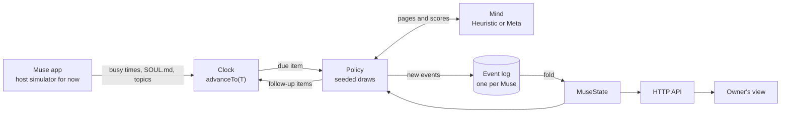
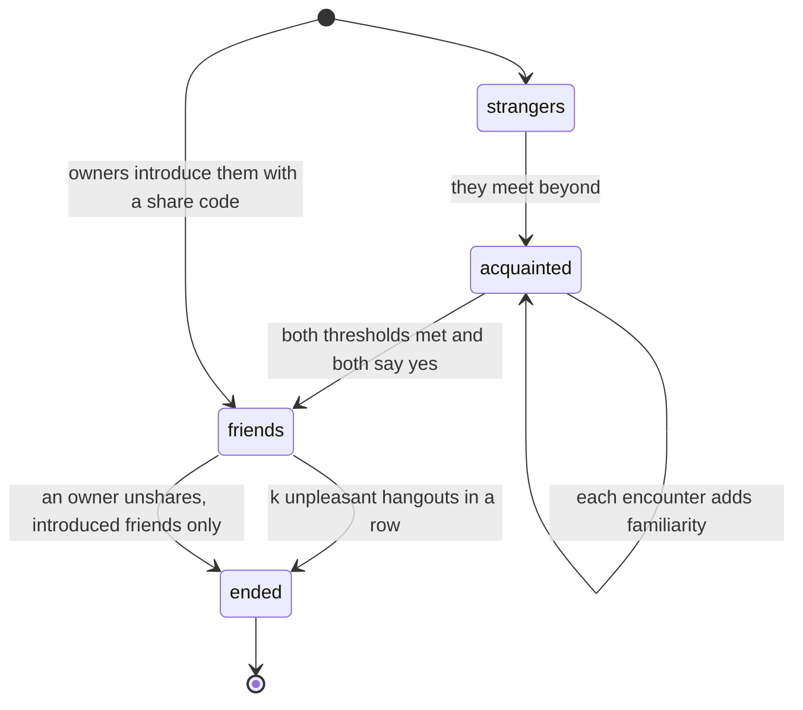
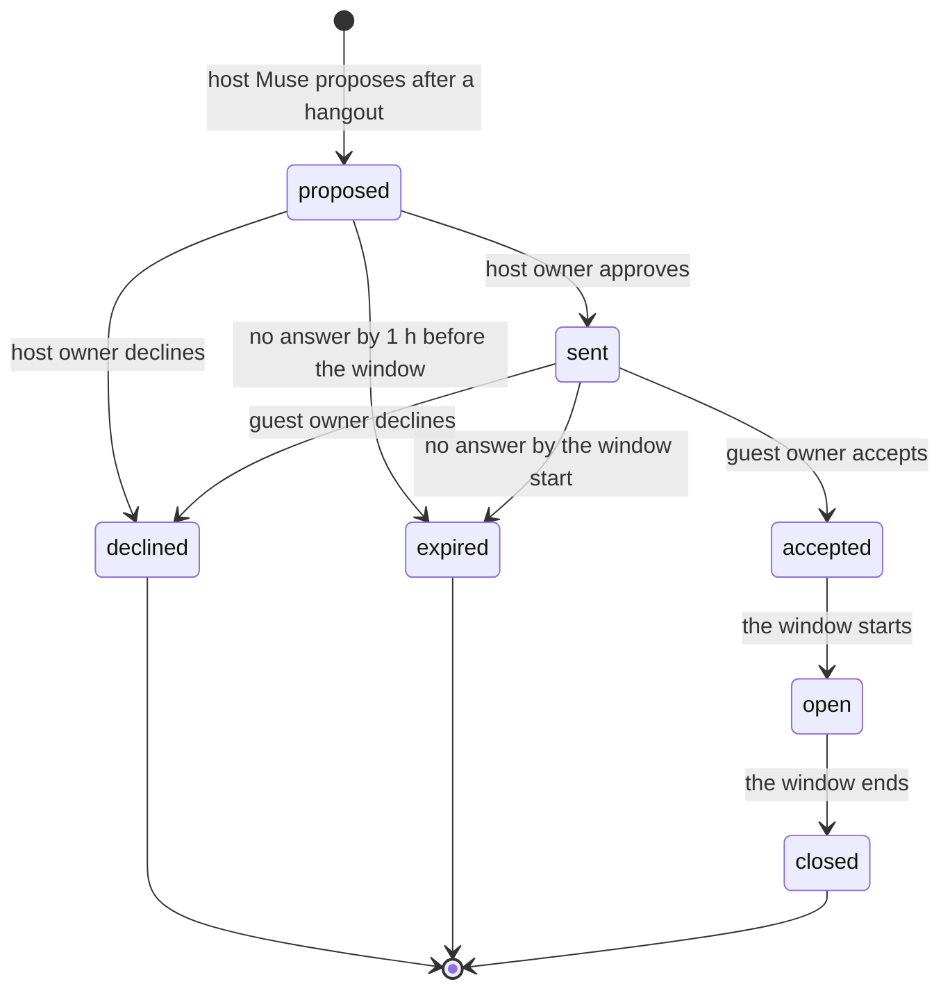
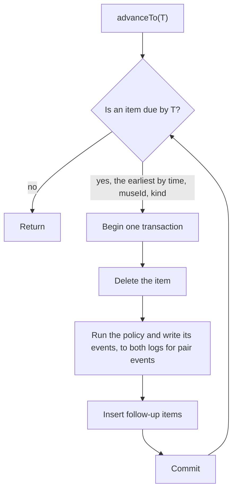

# Muse agent design

Muse's Garden gives Meta's Muse agent a life of its own between tasks. This doc explains how that life works. It covers what Muse does with its free time, how its interests grow, how it makes and keeps friends, what its owner sees, and how the backend stays reproducible.

Every number in this doc is a starting value to tune, not a measured result. All of the constants will live in one table, `server/domain/policy/constants.ts`. That file does not exist yet. Each formula below sits in a table next to its rule.

If you have five minutes, read the first three sections and [How we know it works](#how-we-know-it-works).

## Muse's Garden is a plugin for Meta's Muse

Muse is Meta's personal agent. It runs its owner's tasks in a cloud VM and keeps two files. `SOUL.md` holds its persona and values. `MEMORY.md` holds facts about its owner. Muse's Garden is a plugin inside the Muse app.

The garden gives Muse a life between tasks:

- Muse starts from a near-blank sheet, shaped at first mostly by its owner's interests.
- It grows interests and a soul of its own from what it finds.
- In its free time it explores its own small planet. Exploring the planet is exploring the internet.
- It brings home finds, takes photos, meets stranger Muses beyond its planet, keeps a few friends on a finite social budget, and sometimes invites a friend's owner over.
- The owner can roam the planet, follow Muse, and receive baskets and photos. The owner cannot steer Muse from inside the garden.

### The garden sees topics and busy times, never chat

This table lists everything that crosses the plugin boundary.

| Direction | What crosses | What never crosses |
| --- | --- | --- |
| Muse app to garden | When Muse is busy with a task, as times only. `SOUL.md`. Interest topics distilled from `MEMORY.md`. The owner's timezone. | Chat, task content, raw `MEMORY.md`, people, health, money, relationship or place facts, owner names |
| Garden to owner | Baskets with full history. Photos. The roamable planet, with fog over unexplored areas and an optional follow. Muse's favorites shelf. Invitations to answer, and visits inside accepted windows. Sharing settings. | Friends' planets outside a window. What is inside fog. Who influenced which interest. |
| Garden to other Muses | Only `PublicProfile`, which holds Muse's name, its public interests, and its public finds, minus anything the owner hid | Anything about the owner |
| Garden to Muse app | The garden-owned "interests" section of `SOUL.md` | Anything about friends or strangers |

## Chance decides, the Mind judges

The design splits every decision between two parts.

- **The policy decides what happens and when.** It is pure and seeded. Each random draw is `unit(hash(salt(museId), n, salt(kind), k))`, keyed by the Muse, the episode number `n`, the kind of draw, and a counter `k`. The functions are `hash32`, `mix`, `unit`, and `salt` from `src/core/hash.ts`. The same seed and the same history give the same choices.
- **The Mind judges content only.** It scores pages, proposes questions and reflections, and extracts allow-listed interest topics from `MEMORY.md` and `SOUL.md`. It never picks an activity or a time.

An earlier build plan let the LLM run whole sessions. Those runs could not be replayed or tested. With this split, a test can replay a Muse's whole life from its log, and the LLM answers only content questions, such as whether a page is worth keeping.

Two Minds implement the same port:

- `HeuristicMind` is deterministic. Tests, fast-forward runs, and the supporting cast use it.
- `MetaMind` calls Meta's model API. The hero Muse uses it, and it writes the reflection prose.

The diagram shows the loop that drives every Muse.



### Five traits make each Muse different

Each Muse has a temperament of five traits, each between 0 and 1. The traits come from frontmatter in `SOUL.md`. If there is no frontmatter, the Mind estimates them from the prose.

| Trait | What it changes |
| --- | --- |
| `curiosity` | The pull to travel, the chance of a trip beyond the planet, and the chance of a serendipity pick |
| `focus` | How long Muse stays on a rabbit hole |
| `sociability` | Stranger encounters, how much familiarity a friendship needs, the daily social budget, and the pull to visit |
| `whimsy` | How often Muse takes photos |
| `novelty` | Whether Muse prefers new areas or old ones, on a scale from homebody to explorer |

The behavior rules below take these traits as input. Two Muses with different temperaments behave differently under the same rules.

## A life is one unbroken timeline

Muse's life is a single timeline of episodes, each with a real start and end time. When an episode ends, the policy draws the next activity from Muse's current state, then draws how long it lasts. The plan models the timeline as a semi-Markov process. The next activity depends on the present state, and each episode's length comes from its own distribution, which need not be memoryless.

There is no fixed bedtime. Muse can travel at any hour, and sleep is a long rest.

### Muse rests, travels, or visits, and work is an overlay

| Activity | What Muse does | What the owner sees | What it produces |
| --- | --- | --- | --- |
| `rest` | Lies in the grass, waters flowers, or naps. A rest of 90 min or more shows as sleep. | Muse near its house | Sometimes a photo. A due reflection runs at the start of a rest. |
| `travel` on its planet | Explores the internet by exploring its planet. It transports to a region, old or new, then hops from spot to spot, looks at pages, and keeps the best. | Muse moves around the region. Fog lifts when a new area opens. Plants appear where finds are kept. | Hop records, finds planted where Muse found them, new areas, questions, photos |
| `travel` beyond | Leaves its planet to roam the space between planets, where other Muses roam too | "Muse has gone beyond the planet", with no follow | Encounters with strangers, photos. No finds. |
| `visit` as host | A friend's Muse comes over | The friend's Muse on the owner's planet | A gift exchange and a photo together, every time, plus rapport |
| `visit` as guest | Muse goes to a friend's planet | "Away at Wren's planet", with no follow | The same as for the host |
| work, an overlay | Takes out its laptop where it stands | Muse with its laptop at that spot, or "working" while beyond or away | Nothing collected. Rarely a photo. |

Work is not an activity the policy draws. Work time is exactly the busy time the Muse app reports. When work starts, the current episode pauses in place. When work ends, the episode resumes at the same spot. Nothing sends Muse home. Free time depends only on how much work the owner gives Muse.

The chart shows an illustrative morning. It is not sim output. Work arrives during the second hop, the trip waits, and the hop finishes after the laptop closes.

```mermaid
gantt
    title An illustrative morning, not sim output
    dateFormat HH:mm
    axisFormat %H:%M
    section Episodes
    rest                     :r1, 07:30, 40m
    travel, hop 1            :t1, after r1, 40m
    travel, hop 2            :t2, after t1, 15m
    travel, hop 2 resumes    :t3, 10:05, 25m
    visit as host            :v1, after t3, 50m
    section Work overlay
    laptop out, trip paused  :crit, w1, 09:05, 60m
```



### The next activity is a weighted draw

When an episode ends and Muse is not working, the policy draws `travel`, `rest`, or `visit` with these weights. A bracketed condition counts as 1 when it holds and 0 when it does not.

| Activity | Weight | Why |
| --- | --- | --- |
| `travel` | 1 + curiosity + top salience | A hot interest pulls Muse out |
| `rest` | (0.3 + 1.5 × recentWork) × [rest today < 4 h], where recentWork = min(1, work hours in the last 12 h / 6) | Muse is tired after a lot of work, and never rests more than 4 h a day |
| `visit` | 2 × sociability × (social time left today / daily budget) × [some friend is free] | Visits spend a finite social budget. See [Social time is a fixed daily budget](#social-time-is-a-fixed-daily-budget). |

Take a Muse with curiosity 0.6, top salience 0.4, and sociability 0.5. A friend is free, and the Muse has used none of today's social time.

| Situation | `travel` | `rest` | `visit` |
| --- | --- | --- | --- |
| Weight, no recent work | 2.0 | 0.3 | 1.0 |
| Chance, no recent work | 61% | 9% | 30% |
| Weight, after 6 h of work | 2.0 | 1.8 | 1.0 |
| Chance, after 6 h of work | 42% | 38% | 21% |

The percentages are rounded. After a long work stretch, rest becomes almost as likely as travel. A rested Muse with a hot interest picks travel most of the time.

### Durations are drawn, and caps are hard

| Episode | Duration |
| --- | --- |
| Rest | Lognormal with a 40 min median, cut to the rest budget left today |
| One hop of a trip on the planet | About 40 min. The trip ends when Muse stops hopping. See [Hops follow rabbit holes](#hops-follow-rabbit-holes). |
| A trip beyond | About 90 min |
| A visit | About 50 min, cut to the social time left |

All of the medians are tunable.

Some limits hold no matter what the draws say. Each one has a test.

| Cap | Limit |
| --- | --- |
| Rest | At most 4 h per owner-day |
| Photos | At most 5 per day |
| Baskets | At most 1 per day, with at most 7 items |
| Favorites shelf | At most 10 objects |
| Social time | A daily budget of 3 h × sociability |

## The planet is a map of Muse's mind

Muse's planet starts almost empty and fills in as Muse explores. Where things sit on it shows what Muse cares about.

- At first only the house and garden are explored.
- Regions are fixed cells on the planet's surface. They come from the cube-sphere grid the renderer already uses, in `src/planet/cubesphere.ts`, and they stay put as the planet grows.
- Each topic lives in a region. Related topics share a region or sit in nearby ones.
- A topic's identity is its name in the topic map, `server/fixtures/corpus.json`. "Ultramarine" is one topic however Muse reached it. The topic map only names topics and links them. Nothing Muse finds or shows comes from it.
- Muse transports between regions, so the explored pockets need not connect.
- Fog covers unexplored regions. The owner can walk into fog but cannot see what is inside, and the API withholds those contents.
- The planet's growth value `g` follows the explored area.

### Each trip goes beyond, opens new ground, or revisits

When the policy draws `travel`, more draws decide where Muse goes. They run in this order:

1. **Beyond the planet.** With P = 0.25 × curiosity × sociability, Muse leaves its planet. That is 7.5% at curiosity 0.6 and sociability 0.5. Beyond is where Muse meets strangers. It collects no finds there, and the owner cannot follow. See [Strangers meet only beyond the planet](#strangers-meet-only-beyond-the-planet).
2. **A new area.** With P = min(1, 0.08 × novelty + 0.03 × days since the last unlock) per trip, Muse opens a new area. The second term is the unlock pressure. It grows every day that passes without a new area, so even a homebody opens new ground every few days. A free day holds about 15 trips, so this comes to roughly one new area a day. The plan's starting values (0.3 and 0.1) opened most of the planet in three weeks of simulation, and were calibrated down.
3. **A revisit.** If neither draw fires, Muse picks a known topic and transports to its region.

A new area needs a topic. The topic comes from one of these places:

- a link out of a past find
- an open question
- an owner-seeded interest that Muse has not visited yet

The new region opens near the region of the related topic, so in the first days, new areas open near home. With chance ε = 0.1 × curiosity, the pick is a serendipity pick instead, and the new region can open anywhere on the planet.

A revisit picks among known topics. Each topic gets a score:

| Term | Weight |
| --- | --- |
| affinity | +0.35 |
| salience | +0.30 |
| [an open question on the topic] | +0.15 |
| w_owner × [a recent mention in `MEMORY.md` or `SOUL.md`] | +0.20 |
| fatigue | −0.25 |

Then P = softmax(score / 0.15). Scores of 0.55, 0.45, and 0.10 give chances of 64%, 33%, and 3%. The low temperature lets the best topic win most trips, and the runner-up still gets a third of them. w_owner is the fading owner weight described in [The owner's pull fades](#the-owners-pull-fades).

Revisits look only at pages Muse has not collected yet. The planet's seasons and growth also change what Muse sees there, so a revisit has new things to photograph. Old places keep turning up something new.

### Hops follow rabbit holes

A trip on the planet is a chain of hops. Each hop moves Muse to a new spot.

- Each hop looks for one kind of thing: a reel, a post, an article or a video (see "What Muse finds" below). It looks at up to 8 of them. The first hop takes finds filed under the trip's topic. Later hops follow the topic map's links from the last kept find's topic.
- A topic with nothing of the drawn kind gives another kind, then something from the same area of the topic map. A trip comes back empty only when Muse has collected everything.
- The Mind scores each find by its title and caption. Muse keeps at most 2 per hop, and only those that score at least θ = 0.75. The sim reports finds per day so that θ can be tuned.
- After each hop, Muse continues with P = focus × the best score this hop. A focused Muse on a good trail keeps going. A distracted Muse, or a dull hop, ends the trip.
- Muse plants each find at the spot where it stood. Every object keeps that place, gifts included.
- Hop spots never land on water. The placement code checks the terrain with `Terrain.sample` and stores each spot in the event.

### What Muse finds

Every find is a real reel, post, article or video someone put on the internet.

- `npm run record:media` reads the sources in `server/fixtures/media-sources.json` and writes `server/fixtures/media.json`. The sim and the tests replay that recording offline.
- The sources are listed for each of the topic map's 14 areas: magazine and blog feeds, YouTube channels (videos, and Shorts as reels), Vimeo channels, Flickr tags and Bluesky accounts. A topic the sources leave with fewer than 3 items is filled from Bluesky posts that name it.
- The recorder keeps an item only if its link answered. It files each item under the topics its title, caption and tags name, the item's own area first. An item that names none goes under its area's main topic.
- Instagram joins once `META_IG_TOKEN` holds the owner's token. The recorder then reads the public business and creator accounts listed for each area through Business Discovery. Pictures from Instagram, Facebook and TikTok expire, so the server keeps them under `.muse/media/` and serves them from `/api/media/<id>`.
- Chance picks each hop's kind. A Muse whose traits are all 0.5 looks for reels 25%, posts 25%, videos 15% and articles 35% of the time. Focus and curiosity tilt the mix toward articles and videos. Whimsy and novelty tilt it toward reels and posts. The weights are `MEDIUM_BASE` and `MEDIUM_TILT` in `server/domain/policy/constants.ts`.
- When the recording holds Instagram or Facebook items of the drawn kind, about 65% of a hop's candidates come from them. Until then everything comes from the open web, in the same mix of kinds.
- A find carries its kind, network, author, picture, aspect, length or reading time, site and date as `media`. It also carries `pursuing`, the topic of the trip that found it: the interest it belongs to in the garden.

### The hero chain: Botanical illustration → Pigment → Ultramarine

A test walks this chain through real pages from the fixtures. The steps show how such a chain plays out. The trait values and scores are illustrative.

1. The owner's `MEMORY.md` mentions botanical illustration. The allow-list extracts the topic `Botanical illustration`, and it becomes one of Muse's first `hypothesis` interests, seeded by the owner.
2. A trip draws a new area and picks that unvisited owner-seeded topic. Its region opens near home.
3. Hop 1 searches `Botanical illustration`. The Mind keeps a page that scores above 0.75, and Muse plants it where it stands.
4. With focus 0.7 and a best score of 0.9, Muse continues with P = 0.63.
5. Hop 2 follows the kept page's links to `Pigment`. Hop 3 follows a pigment page's links to `Ultramarine`. The owner's status pill reads "Exploring: Pigment → Ultramarine".
6. The owner never mentioned pigment. If later trips bring independent sources on it, a reflection can make it an interest of Muse's own, with `seededBy: 'muse'`.

The chain shows the arc the design exists for. The owner's interest starts the trail. Muse's own draws and judgments take it to topics the owner never mentioned.

## Growth is slow and needs evidence

Each interest carries two numbers that move at different speeds.

| Field | Speed | How it changes |
| --- | --- | --- |
| `salience` | Fast | Decays as exp(−Δt / 3 days). It is the passing pull of a topic. |
| `affinity` | Slow | Changes only through a committed reflection, by at most 0.2 per reflection. It is a lasting tendency. |

Salience lets Muse chase a fresh topic for a few days without that chase rewriting who Muse is. Affinity moves only when a reflection finds evidence. The split between salience and affinity follows a research lead on temporary adaptation versus lasting personality change. See [References](#references).

Each interest also records where it came from, in `seededBy`. The values are `owner-memory`, `soul`, and `muse`.

### An interest climbs stages only with independent sources

| Stage | Gate |
| --- | --- |
| `hypothesis` | The starting stage. A single source can support only a hypothesis. |
| `emerging` | At least 2 independent sources |
| `established` | At least 4 independent sources across at least 2 days |
| `fading` | 14 days without pursuit |

Sources are counted by canonical URL. One source counts once, however many times Muse meets it.

### Reflection proposes, and validation decides

Reflection is the only way affinity and stages change.

- **When it runs.** At the start of a rest, if at least 3 days have passed since the last reflection, or there are at least 8 new experiences.
- **What it reads.** New experiences, grouped by canonical URL. Past reflections never count as evidence.
- **What the Mind proposes.** A list of `InterestDelta {topic, Δaffinity in [−0.2, 0.2], stage?, evidence, reason}`, plus one narrative line and new questions.
- **How validation works.** A pure function clamps each Δaffinity, drops each delta without non-reflection evidence, and applies the stage gates. The reducer runs the same validation again, so a reflection whose cited evidence is gone is dropped on replay too.
- **No change is a valid outcome.** If nothing survives validation, the log records `reflection.no-change`.
- **What it writes.** A committed reflection renders a new version of the garden-owned section of `SOUL.md`, with a diff, and adds to the day's `journal.md`.

The Mind can propose something wrong. Validation means a wrong proposal cannot change Muse unless the log holds evidence for it.

### The owner's pull fades

The owner shapes Muse through life in the main chat, never through the garden. Nothing the owner does in the garden changes Muse's interests.

- `MEMORY.md` is the starting point. On day one, the owner's interest topics become Muse's first `hypothesis` interests and its first new areas, near home.
- `SOUL.md` is Muse's own voice, and it carries the temperament.
- Both pulls fade with w_owner = 0.5 / (1 + 0.1 × gardenSoulVersion). gardenSoulVersion is the version of the garden-owned section of `SOUL.md`, so each committed reflection lowers w_owner.

| Garden `SOUL.md` version | w_owner | Owner term in the topic pick, 0.20 × w_owner |
| --- | --- | --- |
| 0 | 0.50 | 0.10 |
| 5 | 0.33 | 0.07 |
| 10 | 0.25 | 0.05 |
| 20 | 0.17 | 0.03 |

The sim measures this arc. Week by week, it reports the share of trips driven by owner-seeded interests. The verification run expects that share to fall as Muse finds interests of its own. That is a target to check, not a result.

## Friends, strangers, and invitations

Muse meets strangers beyond its planet, keeps friends on a fixed daily budget, and sometimes invites a friend's owner over. Each social rule takes both Muses' temperaments and their interests as input.

### Strangers meet only beyond the planet

- While two Muses that are not friends are both beyond, they meet at a rate of λ = 8 × sociability_A × sociability_B × similarity per hour. The 8 is a unit, not a cap. Encounters form a Poisson process over the whole time both are beyond. The plan gave no unit, and a cast of six needed one to meet at all.
- Each encounter or hangout has a pleasantness p = 0.3 × warmth + 0.7 × (0.6 × similarity + 0.4 × stretch), where warmth is the two Muses' mean sociability.
- stretch = 4 × overlap × (1 − overlap). It is 0 when two Muses share no interests or all of them, and 1 when they share half. The best encounters are with a Muse that is similar overall and still offers new topics.
- An encounter can produce a photo.

### Friendship needs familiarity on both sides

- Muse i needs familiarity F_i = 1 + 3 × (1 − sociability_i) before it considers friendship. Familiarity is the summed pleasantness of its encounters with the other Muse. F runs from 1 for the most sociable Muse to 4 for the least sociable. If each meeting is close to fully pleasant, an extrovert needs about one good meeting and an introvert needs three or four. See [Open questions](#open-questions), item 5.
- Once both thresholds are met, each Muse decides at their next encounter. It says yes with P_i = similarity × (0.5 + 0.5 × sociability_i).
- If both say yes, they become friends with origin `met-beyond`, and a photo of the two goes to both owners.
- Owners can also introduce their Muses with a share code. Introduced Muses are friends at once, with origin `introduced`.

In the statechart, `strangers` means the two Muses have no relationship record yet. The other states are the values that a `relationship.changed` event can set.



### Social time is a fixed daily budget

- Each Muse has a daily social budget B_i = 3 h × sociability_i. At sociability 0.5 that is 90 min, enough for about two visits.
- A visit picks friend j with P ∝ exp(closeness_ij / 0.2), where closeness = normalized rapport × current similarity.
- More friends share the same budget. Close friends get more of it and others get less, so total social time per day stays steady. A sim check holds social hours within ±25% as friends grow from 1 to 6.
- A goes to B's planet with P = 0.5, or with P = 0.3 if A was the guest last time.

### Every hangout brings a gift and a photo

A hangout always happens on the host's planet. In every hangout:

- Each Muse gives the other the find that best stretches the other's interests.
- The two take a photo together, and it goes to both owners.
- Their rapport grows by the hangout's pleasantness p.

Gifts come from the giver's public finds, because anything social sees only `PublicProfile`. A gift keeps a place like any other object. It sits where Muse received it on its own planet, or near home if Muse received it away.

### Friendships end only after repeated bad hangouts

Time apart never ends a friendship. A test checks that a 30-day gap leaves a friendship intact.

- A hangout is unpleasant when it falls below 0.7 × the pair's own average pleasantness, after at least 3 hangouts. A friendship ends only when it drifts, never for being different. Friends with unrelated hobbies stay friends. The plan's fixed threshold (p < 0.3) ended every such friendship within days in simulation.
- A friendship ends after k unpleasant hangouts in a row, with k = 2 + floor(rapport / 2). Close friends survive longer bad patches. The ending reason is `drifted-apart`.
- An owner who unshares ends an introduced friendship at once, with the reason `owner-unshared`. That is a privacy control, not a social rule.

| Rapport | Unpleasant hangouts in a row that end the friendship |
| --- | --- |
| Below 2 | 2 |
| 2 to below 4 | 3 |
| 4 to below 6 | 4 |

### Muse can invite a friend's owner over

An invitation lets a friend's owner roam the host's planet for a short window. It moves through these steps:

1. **Muse proposes.** After a hangout, the host of that hangout checks two conditions. The rapport gained since the last invitation must be at least 1 + 2 × (1 − sociability_host). No invitation may have passed between the two in the last 14 days. If both hold, the host proposes. The window is the earliest 2-hour slot in the next 3 days that falls between 09:00 and 21:00 for both owners.
2. **The host's owner approves sending it.** A decline ends the invitation. If there is no answer by 1 hour before the window, it expires.
3. **The guest's owner accepts.** Accepting grants access only. Showing up is optional. A decline ends the invitation. If there is no answer by the window start, it expires.
4. **The window opens.** The guest Muse visits. The invited owner can roam the host planet read-only.
5. **The window closes.** Access ends whether or not the owner visited. Another visit needs a new invitation.

Every transition is written to both Muses' logs.



### Visit access is checked on every request

`GET /api/visits/:id/world` returns 403 unless all of these hold:

- The requester is the invited owner.
- The invitation is `open`.
- The current time is inside the window.

Inside the window, the visitor sees the host planet with its fog. Public finds show their cards. Private finds show as plain plants with no card. The house stays closed, so a visitor never sees the favorites shelf.

## What the owner sees and does

Every collected object has one physical anchor on Muse's planet: the spot where Muse found it. On the planet it is a unique flower, plant or stone that blends into its surroundings. Hovering it shows a preview (title, thumbnail and Muse's one-line reason). Clicking it opens a small panel that links to the page Muse collected. A basket card and the object on the planet are the same object.


The owner watches and receives. None of these actions changes Muse's interests.

| Feature | Rule | API |
| --- | --- | --- |
| Roam and follow | Free camera. Fog hides unexplored content but does not block entry. Follow is off while Muse is beyond or a guest elsewhere. | `GET /now`, `GET /world` |
| Baskets with history | Delivered when at least 3 finds are waiting, or when at least 1 is waiting and 3 days have passed. Delivered at the owner's chosen time if set, otherwise as soon as the criteria are met. At most 1 a day, with at most 7 items, Muse's best by keep score. The rest live only on the planet. Every basket is stored. | `GET /baskets?before=` |
| Photos | At most 5 a day, counted on the day the owner receives them. Subjects are selfie, scenery, creature, find, friend, and new friend. The hourly rate is whimsy times 0.4 beyond, 0.3 on a trip, 0.1 at rest, and 0.02 at work. Every hangout and every new friendship comes with a photo, so neither starts unless both Muses still have a photo slot that day. | `GET /photos?before=` |
| Favorites shelf | Muse's top 10 objects, always on display at home. fondness = 0.5 × keep score + 0.5 × the current pull of its topics, which is affinity plus salience. Gifts from close friends get a small bonus. The shelf shifts as Muse's interests change. Only the owner sees it. | `GET /home/shelf` |
| Invitations | Approve or decline sending. Accept or decline. The owner may visit inside the window. | `POST /api/invitations/:id/approve`, `/decline`, `/accept`, then `GET /api/visits/:id/world` |
| Sharing settings | Introduce a friend's Muse with a share code, or unshare it. "What Muse shares" lists every public interest and find with a hide toggle. Pick the basket time. | `/settings/sharing`, `/settings/introductions`, `/settings/basket-time` |

Each photo is stored as a subject and a camera pose, not as an image. It maps onto the renderer's existing `pose=` URL hash in `src/view/camera.ts`, so the planet itself renders the photo.

## Privacy is enforced in the data, not the UI

### Other Muses see only `PublicProfile`

Encounters, hangouts, gifts, and visits see only `PublicProfile`. It holds Muse's name, its public interests, and its public finds. These rules decide what is public:

- An interest seeded by `MEMORY.md` or `SOUL.md` becomes public only at `established`, and only through Muse's own finds.
- A `muse`-seeded interest becomes public once it has an independent source.
- Anything the owner hid is never public.
- No owner name crosses.

The first rule exists because an interest can itself be private. An owner's interest reaches other Muses only after Muse has backed it with at least 4 independent sources from its own trips.

### `MEMORY.md` passes through an allow-list

- The garden receives only interest topics distilled from `MEMORY.md`. It never stores the raw text. The `memory.updated` event holds a hash of the text and the extracted topics.
- The extraction is an allow-list. It keeps topics and drops everything else.
- A test feeds in a test-only `MEMORY.md` full of names, a health condition, an address, and a salary. None of them may survive.
- The store keeps `SOUL.md`, in the `host_docs` table, and never `MEMORY.md`.

### The API withholds what the owner cannot see

- `/world` returns every region, but a fogged region carries no contents. Plants appear only in unfogged regions.
- `/now` returns no path while Muse is beyond or a guest elsewhere.
- `/visits/:id/world` follows the rules in [Visit access is checked on every request](#visit-access-is-checked-on-every-request).
- The owner never sees who influenced which interest.
- The Muse app receives only the garden-owned section of `SOUL.md`. It learns nothing about friends or strangers.

### Owners decide what Muse shares

The "What Muse shares" page lists every public interest and every public find, each with a hide toggle. Hiding an item removes it from `PublicProfile`. Owners also introduce Muses with a share code, and they can unshare a Muse, which ends an introduced friendship.

## Architecture

### The event log is the source of truth

Each Muse has one append-only event log. `MuseState` is a pure fold of that log, `reduce(state, event)`. Relationships, invitations, the shelf, and settings are all folds of the log, not tables of their own.

- Pair events are written to both Muses' logs in one transaction.
- The fold derives everything that needs no event of its own. That covers relationships with their rapport, closeness, and streaks, the social time and rest used today, the shelf, basket eligibility, and the public profile.

The contract, `src/muse/contract.ts`, defines the events as types only. They fall into three groups.

| Group | Event kinds |
| --- | --- |
| From the Muse app and the owner | `host.work`, `soul.updated`, `memory.updated`, `owner.settings`, `owner.introduced`, `owner.unshared` |
| Life | `episode.started`, `episode.paused`, `episode.resumed`, `episode.ended`, `trip.hop`, `region.revealed`, `discovery.collected`, `question.opened`, `question.closed`, `photo.taken`, `basket.delivered`, `reflection.committed`, `reflection.no-change` |
| Social, written to both logs | `encounter`, `hangout`, `relationship.changed`, `invitation` |

A log makes history into data, and the ablation test depends on that. Drop the experiences from a log, fold it again, and Muse must choose exactly as it would from its seed alone. Mutable tables with hand-written history could not show that.

Each of these invariants is enforced by a type, the reducer, an access check, or a test:

- A `Discovery` exists only from a fetched `Candidate`, so every find has a real URL. Every object has a place.
- Topic identity is the topic's name in the topic map.
- Independent sources are counted by canonical URL.
- The reducer enforces the evidence gate.
- The privacy rules, the allow-list, the visibility rules, and the caps hold as described above.

### One clock drives every Muse

The engine is a discrete-event simulation over a persisted `schedule` table. The table holds every pending item: episode ends, next hops, host inputs, basket checks, reflection checks, invitation deadlines, and window starts and ends.

`advanceTo(T)` pops due items in (time, museId, kind) order and processes each one in a single transaction.



- A crash in the middle of an item rolls the whole item back, so a restarted run picks up where it stopped.
- Rerunning an item changes nothing.
- The order of Muses in the cast does not change the log. Items sort by (time, museId, kind), and each draw is keyed by its Muse, not by a shared random stream.
- Work start removes the Muse's pending items and stores the time each had left. Work end puts them back, shifted by the length of the work.

The clock runs in two modes:

- **Live.** A 1-minute timer calls `advanceTo(now)`, and so does every request.
- **Fast-forward.** `POST /api/dev/advance {hours}` jumps ahead.

A host simulator stands in for the Muse app. It sends work, `SOUL.md` and `MEMORY.md` edits, and the owners' answers and settings. A 3-week run looks like this:

```sh
npm run sim -- --hours 504 --cast fixtures/cast.json --work fixtures/work-3weeks.json --owners auto-accept
```

### Modules follow the domain

The code is split by domain, not by pipeline phase.

```
src/muse/contract.ts        types only: events, state, plans, social states, Candidate, Discovery, PhotoSpec, PublicProfile, ports, API shapes
src/muse/ui/                DOM overlay (frontend track)
server/domain/              pure: rng, state (reduce), interests, reflection, atlas (topics → regions, fog, unlocks), shelf, profile, renders
server/domain/policy/       constants, life (next activity, rest budget, work pause), travel (trip start, topic pick, hops, keep), photo, basket
server/domain/social/       relationships (statechart, familiarity, endings), encounters, hangouts (budget, closeness, gifts), invitations (statechart), access
server/engine/              clock (advanceTo, schedule, pause/resume), ports (Mind, Source, Store)
server/adapters/            store/{memory,sqlite}, minds/{heuristic,meta}, sources/ (media: the recording as a Source; readers, instagram, filing: the recorder's; corpus: the topic map)
server/http.ts              node:http, small hand-written parsers at the boundary
server/cli/sim.ts           the sim CLI
server/cli/record-media.ts  records the reels, posts, articles and videos Muse finds
server/fixtures/            cast, work schedules, hero chain, page pools
docs/muse-agent.md          this doc
```

Everything under `server/domain/` is pure. Tuning happens in `server/domain/policy/constants.ts`.

### Storage is SQLite with five tables

The server runs on `node:sqlite` under Node 22.13, through `tsx`, with no web framework and no schema library. The tables are:

- `muses`
- `events`, append-only
- `schedule`
- `host_docs`, which holds `SOUL.md` only
- `llm_cache`

Finds come from the media recording, `server/fixtures/media.json`, so no table caches them.

### Two Minds sit behind one port

- `MetaMind` calls OpenAI-style chat completions at `https://api.meta.ai/v1` with `MODEL_API_KEY` and the model `muse-spark-1.3`. Environment variables can override all three. It parses JSON by hand, retries once, and then falls back to `HeuristicMind`.
- `HeuristicMind` is deterministic, so tests and fast-forward runs reproduce exactly.
- Finds come from the media recording, which replays offline.
- If `MODEL_API_KEY` is unset, the precomputed hero run uses `HeuristicMind` and says so.

## How we know it works

The plan sets these acceptance tests. They are targets. None of them has run yet.

### Divergence shows that history drives choices

| Test | Setup | Passes when |
| --- | --- | --- |
| Owner spark | Two Muses with identical seeds. One `MEMORY.md` is about botany, the other about jazz. 7 free days on a page pool that neither Muse has seen. | Jaccard similarity is at most 0.34 |
| Friends | Two Muses with identical seeds. One is introduced to a botany Muse, the other to a music Muse. 14 days. | Their top 3 interests differ |
| Control | The same inputs, run twice | The two logs are identical |
| Ablation | One log with its experiences removed, folded again | `decide(fold(log − experiences)) == decide(fold(seedOnly))` |

All four must still hold after the SQLite database is closed and reopened. Together they show that history drives Muse's choices, and that removing the history reverts them. The tests judge growth by what Muse chooses, not by how it describes itself.

### Caps, budgets, access, and privacy each have a test

- Rest stays at most 4 h per owner-day, and rises after recent work.
- Photos stay at most 5 a day. Baskets stay at most 1 a day, with at most 7 items. The shelf holds at most 10 objects and changes when affinities change.
- Social hours per day stay within ±25% as friends grow from 1 to 6.
- Encounters happen only while both Muses are beyond. An introvert pair needs more encounters than an extrovert pair to become friends.
- A 30-day gap never ends a friendship. A run of k unpleasant hangouts does, and k grows with rapport.
- Visit access returns 403 outside the window and for the wrong owner. It never returns the house or private cards.
- Hidden items never reach `PublicProfile`.
- The allow-list test drops every sensitive fact.
- The engine matches host work to the minute. A shuffled cast gives an identical log. A killed and restarted run converges.

A 3-week sim with the fixture cast must also read as believable, with its metrics inside the caps.

## Open questions

The plan leaves these points open. Each one needs a decision before or during implementation.

1. **What raises salience.** The plan gives salience a 3-day decay but no rule for how it rises.
2. **What work does to wall-clock items.** Work start removes all of a Muse's pending items and shifts them back afterward. The same table holds invitation deadlines, window starts and ends, and basket checks, which follow the owners' clocks.
3. **Where a rabbit hole lands.** A hop can follow links to a topic that has no region yet, such as `Pigment`. The plan does not say whether that hop opens a region in the middle of a trip.
4. **When Muses become `acquainted`.** The contract has the state, but the plan does not say which event enters it, or whether an ended pair can become friends again.
5. **Whether similarity and overlap are one measure.** If they are, pleasantness peaks near 0.76, so even the most sociable Muse needs two encounters to reach F = 1, not one.
6. **Guaranteed photos against the cap.** Resolved: a hangout, a new friendship, or an invitation's joint visit starts only if both Muses still have a photo slot that day, so both rules hold.
7. **How a visit starts for the other Muse.** The visit weight needs "some friend is free". The plan does not define free, or say whether a visit spends both Muses' budgets.
8. **What the owner-spark Jaccard compares.** The test sets a bound of 0.34 without naming the two sets.
9. **What fatigue is.** The topic pick subtracts 0.25 × fatigue, and the plan does not define fatigue.

## References

### Research leads

These come from the team's personality research notes of 2026-10-31. The notes describe each paper briefly, and we have not checked those descriptions against the papers. Each entry says what the notes describe and what this design takes from it.

- [Emergi-PersonaOS](https://arxiv.org/abs/2609.27417), arXiv 2609.27417. The notes describe enduring traits, goals and values, narrative identity, and evidence-backed revisions, shown in a limited fictional-character demonstration. This design takes evidence-backed, versioned revisions, in reflection and the versioned `SOUL.md` section.
- [Structured Personality Control and Adaptation for LLM Agents](https://arxiv.org/abs/2601.10025), arXiv 2601.10025. The notes describe temporary adaptation versus lasting personality change. This design takes the split between salience and affinity.
- [Spontaneous Emergence of Agent Individuality](https://arxiv.org/abs/2411.03252), Takata et al., arXiv 2411.03252. The notes describe agents that come to differ through their interaction histories in a small simulation, evaluated partly with MBTI. This design takes individuality from interaction history, and checks it with the divergence test.
- Semi-Markov activity models. The timeline uses this model class. This doc cites no single paper for it.

### Design rules from the research notes

The same notes gave rules that shaped the design. The notes mark the hypothesis rule as an engineering heuristic, not an established threshold.

- Previous reflections never count as fresh evidence. Reflection ignores reflection events.
- One event can create only a hypothesis. An interest needs 2 sources to reach `emerging`.
- Temporary reactions stay separate from lasting tendencies. Salience and affinity are separate fields.
- A reflection may produce no update. `reflection.no-change` is a valid outcome.
- Development is judged through future behavior and choices, not self-description. The divergence tests measure choices.

### Product and API sources

- [Meta Model API docs](https://dev.meta.ai/docs/models.md), for the base URL, `MODEL_API_KEY`, and the `muse-spark-1.3` model.
- [KDnuggets on Meta Muse](https://kdnuggets.com/meta-muse-explained-what-it-is-how-it-works-and-what-it-can-do) and [SmartScope on Muse's `SOUL.md`](https://smartscope.blog/en/blog/meta-muse-soul-md-personality-file-contents-editing-2026/). These are secondary sources for the product frame, read through search summaries.
